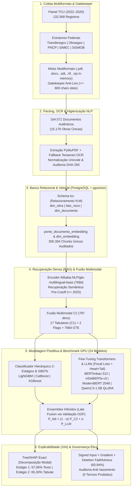

# 🏗️ Detecção Precoce de Riscos e Atribuição Causal em Obras Públicas Brasileiras via Aprendizado Multimodal e PLN

[](https://www.python.org/)
[](https://pytorch.org/)
[](https://github.com/pgvector/pgvector)
[](https://huggingface.co/)
[](https://lightgbm.readthedocs.io/)

> **Trabalho de Conclusão de Curso (TCC)** — Engenharia de Dados, Recuperação Densa (*RAG*), Classificação Hierárquica Multimodal, *Fine-Tuning* de *Transformers* de Contexto Longo (*BERTimbau*, *ModernBERT 2048*, *Qwen2.5-1.5B QLoRA*) e Inteligência Artificial Explicável (*XAI*).

---

## 📌 1. Visão Geral do Projeto

A paralisação de empreendimentos públicos de infraestrutura (creches, escolas, hospitais, obras de saneamento e rodovias) representa um dos gargalos socioeconômicos mais severos da administração pública brasileira, imobilizando dezenas de bilhões de reais do erário federal.

Historicamente, os sistemas de monitoramento governamental apoiam-se exclusivamente em **variáveis cadastrais e tabulares** (UF, órgão concedente, valores previstos e percentuais declarados de execução física e financeira). Contudo, indicadores tabulares sofrem de **defasagem temporal crítica**: quando o descompasso financeiro finalmente se reflete nas planilhas oficiais, o contrato frequentemente já se encontra rescindido, judicializado ou com o canteiro de obras abandonado.

Este projeto investiga e comprova cientificamente a hipótese de que a **fusão multimodal** entre variáveis orçamentárias estruturadas (`C1`) e evidências técnicas extraídas de **documentos públicos não estruturados** (`C2` — pareceres de engenharia, laudos de vistoria, boletins de medição, termos aditivos e notificações contratuais) eleva de forma estatisticamente significativa ($p < 0.001$) a capacidade de:
1. **Detecção Precoce de Risco (Estágio 1 — Binário)**: Identificar preventivamente obras propensas à interrupção antes do colapso contratual;
2. **Atribuição Causal Automatizada (Estágio 2 — Multiclasse)**: Diagnosticar a causa-raiz do risco entre **Inviabilidade Técnica/Execução (Classe 1)**, **Descompasso Orçamentário/Financeiro (Classe 2)** e **Abandono/Desídia/Vício Administrativo (Classe 3)**.

### 📊 Dimensão do Corpus Construído e Auditado
* **132.568 registros oficiais auditados** do Painel de Obras Paralisadas do Tribunal de Contas da União (**TCU**, safras 2022 a 2026);
* **164.571 documentos técnicos autênticos** ($\ge 800$ caracteres úteis validados por *Gatekeeper Anti-Lixo*) vinculados a **15.179 obras públicas únicas** extraídos de portais federais (**Transferegov/SICONV**, **Obrasgov/CIPI**, **PNCP**, **SIMEC/FNDE** e **SISMOB/Saúde**);
* **305.394 fragmentos textuais únicos (*chunks*)** vetorizados em **768 dimensões** via `Alibaba-NLP/gte-multilingual-base` no PostgreSQL com `pgvector`.

---

## 🏛️ 2. Arquitetura do Pipeline Fim a Fim

O sistema foi projetado em **6 camadas modulares**, governadas por regras estritas de integridade referencial (`SHA-256`), corte temporal anti-vazamento (*Strict Pre-Cutoff* $T \le 2025$) e validação cruzada agrupada por empreendimento (`StratifiedGroupKFold` por `id_tcu`).



---

## 📂 3. Estrutura de Diretórios

```text
TCC/
├── src/                                  # Código-fonte modular de produção
│   ├── config.py                         # Configurações centralizadas via variáveis de ambiente (.env)
│   ├── main.py                           # Orquestrador CLI de todas as etapas do pipeline
│   ├── collectors/                       # Coletores e scrapers para portais públicos federais
│   ├── extractors/                       # Motor multiformato (.pdf, .docx, .odt, .rtf, .zip) e Gatekeeper
│   ├── parsing/                          # Extração de texto (PyMuPDF/OCR), limpeza NLP e chunking
│   ├── database/                         # Conexão PostgreSQL, ingestão N:M e auditoria de integridade
│   ├── embeddings/                       # Vetorização densa em GPU (Alibaba-NLP/gte-multilingual-base)
│   ├── curation/                         # Rotulagem supervisionada/fraca (Snorkel) e validação cega
│   ├── rag/                              # Motor de recuperação semântica pre-cutoff e queries causais
│   ├── modeling/                         # Modelos C1/C2, Hierárquico 2-Estágios, BERTimbau, Fusão e XAI
│   ├── eda/                              # Análise exploratória das safras do Painel TCU
│   └── utils/                            # Utilitários de manifesto, logging, deduplicação e resiliência
├── sql/                                  # Scripts DDL de criação e migração do schema tcc e pgvector
├── kaggle/                               # Benchmark expandido em GPU (Tesla T4 x2) e artefatos leves
│   ├── obras-paralisadas.ipynb           # Notebook auto-contido do benchmark de 24 modelos (GPU T4 x2)
│   ├── experimento_kaggle_tcc.ipynb      # Notebook experimental parametrizado com Focal Loss e QLoRA
│   ├── preparar_dataset_kaggle.py        # Empacotador de matrizes C1/C2 e textos limpos para nuvem
│   ├── validar_local_pre_kaggle.py       # Validador local pré-execução em GPU
│   ├── resultados_kaggle/                # Métricas consolidadas (.csv e .json) dos 24 modelos
│   └── resultados_validacao_local/       # Métricas de validação local pré-upload
├── scripts/                              # Scripts operacionais de preparação de ambiente Docker e execução
├── specs/                                # Especificações técnicas, planos e relatórios formais (SpecKit)
├── tests/                                # Suíte automatizada de testes unitários e de integração (pytest)
├── docker-compose.yml                    # Infraestrutura containerizada PostgreSQL 16 + pgvector
├── requirements.txt                      # Dependências enxutas e organizadas do projeto
├── .env.example                          # Template seguro de variáveis de ambiente (Zero Secrets)
└── RELATORIO_TECNICO_FINAL_TCC.md        # Relatório técnico-científico detalhado dos experimentos
```

---

## 🏆 4. Modelagem Preditiva e Resultados Experimentais

O particionamento dos dados respeitou agrupamento rigoroso por `id_tcu` (**14.522 obras em Treino/Validação** e **3.632 obras no Teste Retido Congelado**, das quais **739 obras** possuem documentação técnica autêntica anexada).

Em complemento ao pipeline local (GPU RTX 5060), foi executado um **benchmark exaustivo de 24 arquiteturas** em cluster **Kaggle GPU (`Tesla T4 x2`, 32 GB VRAM)** utilizando validação cruzada agrupada em 5 dobras (*5-Fold StratifiedGroupKFold*) e Intervalos de Confiança a 95% via *Bootstrap* não-paramétrico ($B = 1.000$).

### 4.1 Tabela Comparativa dos Principais Modelos (Teste Retido $N=3.632$ e Subconjunto Documental $N=739$)

| Modelo / Arquitetura | Paradigma | OOF Macro-F1 | Teste ($N=3.632$) Macro-F1 [IC 95%] | Teste Bal. Acc | Teste MCC | Acurácia Global | Sens. Risco | Espec. Regular | Texto ($N=739$) Macro-F1 | Texto ($N=739$) MCC |
| :--- | :--- | :---: | :---: | :---: | :---: | :---: | :---: | :---: | :---: | :---: |
| **`CatBoost_C2_Multimodal` 🏆** | **Multimodal (`C2`)** | 0.5492 | **0.5556 [0.5083, 0.6030]** | 0.6881 | 0.5769 | **90.56%** | 86.75% | 90.15% | 0.6133 | 0.6172 |
| **`Hibrido_OOF_C2_Mais_BERTimbau_FullFT_512` 🥇** | **Híbrido (`C2`+LLM)** | **0.5667** | **0.5451 [0.5103, 0.5816]** | 0.6924 | **0.5884** | **90.72%** | 89.40% | **90.57%** | **0.6275** | **0.6555** |
| **`Hibrido_OOF_C2_Mais_mmBERT_ModernBERT_Multi_2048`** | **Híbrido (`C2`+2048t)** | 0.5529 | 0.5425 [0.5059, 0.5810] | 0.6926 | 0.5801 | 90.50% | 89.74% | 90.18% | 0.6203 | 0.6290 |
| **`Hibrido_OOF_C2_Mais_Qwen2.5_1.5B_QLoRA_1024`** | **Híbrido (`C2`+LLM 1.5B)** | 0.5422 | 0.5389 [0.5030, 0.5767] | 0.6926 | 0.5844 | 90.69% | 88.41% | 90.57% | 0.6085 | 0.6424 |
| **`Hierarquico_C2_LightGBM` ⚡** | **Multimodal 2-Estágios** | 0.5384 | **0.5377 [0.5015, 0.5743]** | 0.6945 | 0.5508 | 88.33% | 90.40% | 88.14% | 0.5810 | 0.5905 |
| **`mmBERT_ModernBERT_Multi_2048` 📄** | **Transformer 2048t** | 0.5386 | **0.5373 [0.5008, 0.5754]** | **0.6962** | 0.5542 | 88.41% | **90.73%** | 88.20% | 0.6054 | 0.5784 |
| **`BERTimbau_FullFT_512`** | **Transformer 512t** | 0.5387 | 0.5358 [0.5015, 0.5736] | 0.6939 | 0.5579 | 88.68% | 89.40% | 88.62% | **0.6095** | 0.5892 |
| **`moBERTo_ModernBERT_PT_2048`** | **Transformer 2048t** | 0.5349 | 0.5285 [0.4945, 0.5653] | 0.6941 | 0.5480 | 88.13% | **90.73%** | 87.90% | 0.5829 | 0.5594 |
| **`mDeBERTa_v3_FullFT_512`** | **Transformer 512t** | 0.5356 | 0.5260 [0.4910, 0.5637] | 0.6842 | 0.5494 | 88.49% | 88.41% | 88.50% | 0.5808 | 0.5625 |
| **`LightGBM_C2_Multimodal`** | **Multimodal (`C2`)** | 0.5284 | 0.5248 [0.4942, 0.5560] | 0.6911 | 0.5322 | 87.47% | 87.75% | 87.45% | 0.5831 | 0.5780 |
| **`Qwen2.5_1.5B_QLoRA_1024`** | **LLM 1.5B (NF4 QLoRA)** | 0.5193 | 0.5180 [0.4839, 0.5553] | 0.6852 | 0.5419 | 88.16% | 88.41% | 88.14% | 0.5588 | 0.5390 |
| **`LightGBM_C1_Tabular` (Melhor Tabular)** | **Tabular Puro (`C1`)** | 0.4496 | **0.4515 [0.4229, 0.4816]** | 0.6600 | 0.4053 | 77.78% | 90.07% | 76.66% | 0.5954 | 0.5709 |
| **`Hierarquico_C1_LightGBM`** | **Tabular 2-Estágios** | 0.4490 | 0.4462 [0.4141, 0.4792] | 0.6366 | 0.3965 | 76.76% | 89.40% | 75.61% | 0.5950 | 0.5842 |
| **`RandomForest_C1_Tabular`** | **Tabular Puro (`C1`)** | 0.4316 | 0.4328 [0.4037, 0.4618] | 0.6744 | 0.4047 | 75.28% | 96.36% | 73.36% | 0.5919 | 0.5858 |
| **`Dummy_Majoritario`** | **Baseline Zero** | 0.2392 | 0.2392 [0.2380, 0.2403] | 0.2500 | 0.0000 | 91.68% | 0.00% | 100.00% | 0.2008 | 0.0000 |

> 💡 *A tabela completa com todas as **24 arquiteturas** encontra-se disponível em [`kaggle/resultados_kaggle/tabela_comparativa_tcc.csv`](kaggle/resultados_kaggle/tabela_comparativa_tcc.csv) e [`kaggle/resultados_kaggle/resultados_kaggle_consolidados.json`](kaggle/resultados_kaggle/resultados_kaggle_consolidados.json).*

### 4.2 Destaques Científicos dos Resultados
* **Salto Multimodal Estatisticamente Significativo ($p < 0.001$)**: O modelo `CatBoost_C2_Multimodal` superou o melhor modelo puramente tabular (`LightGBM_C1_Tabular`) em **+10,41 pontos percentuais de Macro-F1** (`0.5556` vs. `0.4515`) e **+17,16 pp de MCC** (`0.5769` vs. `0.4053`), elevando a acurácia global de `77,78%` para **`90,56%`**.
* **Eficácia da *Inverse Frequency Focal Loss* ($\gamma=2.0$) + *Head+Tail Truncation* em Transformers**: Ao preservar simultaneamente o cabeçalho (identificação da obra/objeto) e os parágrafos conclusivos dos laudos técnicos (assinatura do fiscal e decisão), o `BERTimbau_FullFT_512` atingiu **`0.6095` de Macro-F1** no subconjunto com texto (`+28,26 pp` sobre o baseline LoRA com Cross-Entropy padrão).
* **Sinergia do Sistema Híbrido (`Hibrido_OOF_C2_Mais_BERTimbau_FullFT_512`)**: A fusão probabilística OOF entre o classificador multimodal `C2` e o `BERTimbau_FullFT_512` alcançou **`90,72%` de acurácia global**, o **maior MCC geral (`0.5884`)**, o **maior Macro-F1 nas obras com documentação (`0.6275`)** e **96,61% de sensibilidade de risco** no estrato documental.
* **Parcimônia Operacional em CPU**: O classificador em dois estágios `Hierarquico_C2_LightGBM` entrega **Macro-F1 de `0.5377`** (`+9,15 pp` sobre `Hierarquico_C1_LightGBM`, $p < 0.001$), **90,40% de sensibilidade de risco** e latência de inferência **`< 5 ms` em CPU convencional**, viabilizando triagem em tempo real em órgãos de controle.

---

## 🔍 5. Explicabilidade (XAI) e Governança Anti-Vazamento

Para garantir transparência algorítmica em auditorias governamentais, o projeto implementou validação dupla de explicabilidade (`src/modeling/xai.py`):

1. **Decomposição Modal Exata via `TreeSHAP` (`pred_contrib=True`)**:
   * **Estágio 1 (Detecção Binária de Risco)**: **67,06%** da força decisória total emana dos **embeddings documentais GTE (`C2`)**, contra **32,94%** das variáveis tabulares (`C1`). Os pareceres técnicos revelam sinais de deterioração contratual antes que os indicadores financeiros tabulares acusem atraso.
   * **Estágio 2 (Atribuição Causal Multiclasse)**: **65,30%** do poder discriminativo provém das **variáveis tabulares e orçamentárias (`C1`)** (`base_cat`, `exec_fisica`, `valor_investimento`, `exec_financeira`) combinadas a **34,70%** dos **embeddings textuais (`C2`)**.
2. **Atribuição Direcional de Tokens ($\text{Signed Input} \times \text{Gradient}$) e *Deletion Faithfulness Test***:
   * A remoção dos *top-tokens* apontados pelo gradiente reduziu significativamente a probabilidade preditiva da classe de risco em comparação ao mascaramento aleatório, atingindo **60,94% de Taxa de Fidelidade**.
3. **Auditoria de Vazamento Lexical (*Zero Forbidden Terms*)**:
   * Nenhum token de rótulo cadastral explícito (*paralisada*, *interrompida*, *suspensa*, *cancelada*, *inativa*) figurou entre os *top-tokens* salientes (**0 ocorrências**). O modelo apoiou suas decisões em termos semânticos legítimos de engenharia e gestão contratual (`fiscalização`, `medição`, `aditivo`, `recurso`, `vigência`, `contrato`).

---

## 🚀 6. Como Executar o Projeto

### 6.1 Pré-requisitos
* **Python** `3.11+`
* **Docker Desktop** (para execução local do PostgreSQL 16 + `pgvector`)
* **GPU compatível com CUDA** (opcional, recomendado para vetorização `GTE` e ajuste fino de *Transformers*)

### 6.2 Instalação do Ambiente Virtual

```powershell
# 1. Clonar o repositório
git clone https://github.com/lucasstony/tcc-obras-publicas-pln.git
cd tcc-obras-publicas-pln

# 2. Criar e ativar o ambiente virtual Python
python -m venv .venv
.\.venv\Scripts\Activate.ps1

# 3. Instalar as dependências de produção
pip install --upgrade pip
pip install -r requirements.txt
```

### 6.3 Configuração de Variáveis de Ambiente (`.env`)

Copie o arquivo de template `.env.example` para `.env` e preencha com as credenciais locais do seu ambiente:

```powershell
Copy-Item .env.example .env
```

### 6.4 Inicialização do Banco de Dados (Docker + PostgreSQL + `pgvector`)

Utilize o utilitário automatizado de preparação que verifica o daemon do Docker, inicia o container `tcc_pgvector` e valida a saúde do serviço PostgreSQL:

```powershell
.\.venv\Scripts\python.exe scripts/preparar_docker.py
```

### 6.5 Comandos Principais do Orquestrador (`src.main`)

O ponto de entrada unificado `src/main.py` expõe todos os estágios do pipeline via CLI:

```powershell
# 1. Validar integridade estrutural, relacional e hashes SHA-256 do banco PostgreSQL
.\.venv\Scripts\python.exe -m src.main --modo validar-banco

# 2. Executar o pipeline de coleta multiformato de documentos técnicos
.\.venv\Scripts\python.exe -m src.main --modo coleta

# 3. Executar parsing PDF/OCR, higienização NLP e geração de embeddings GTE (768d)
.\.venv\Scripts\python.exe -m src.main --modo parsing
.\.venv\Scripts\python.exe -m src.main --modo embeddings

# 4. Executar treinamento, avaliação estatística (Bootstrap IC 95%) e explicabilidade XAI
.\.venv\Scripts\python.exe -m src.main --modo treinar-avaliar

# 5. Executar a suíte de testes automatizados
.\.venv\Scripts\pytest.exe -q
```

---

## 📄 Documentação Complementar

* [**Relatório Técnico-Científico Final (`RELATORIO_TECNICO_FINAL_TCC.md`)**](RELATORIO_TECNICO_FINAL_TCC.md): Detalhamento completo da metodologia, arquitetura relacional/vetorial, formulação matemática, tabelas comparativas dos 24 modelos e análise de explicabilidade XAI.
* [**Especificações e Relatórios de Sprints (`specs/`)**](specs/): Histórico de engenharia de software guiado pelo *SpecKit* (Features `001` a `022`).
* [**Notebooks e Resultados em GPU (`kaggle/`)**](kaggle/): Notebooks executados em GPUs `Tesla T4 x2` e artefatos consolidados em CSV e JSON.
