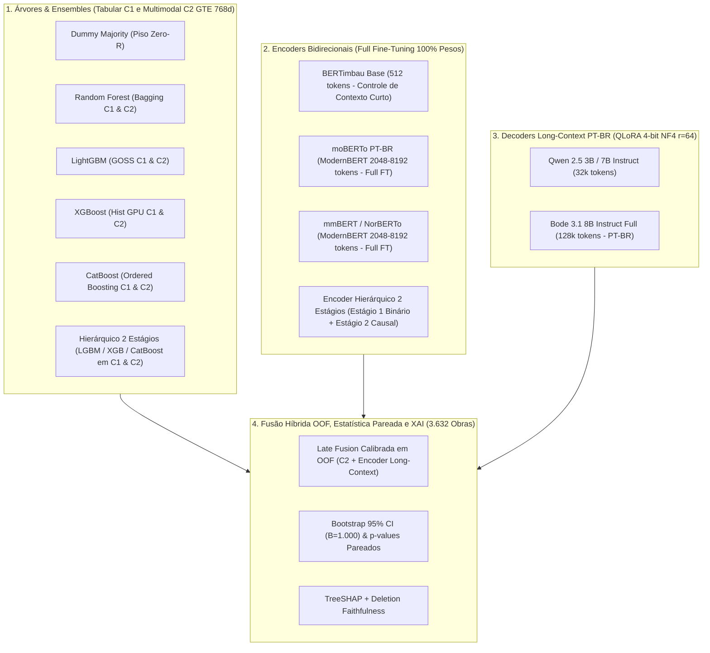

# Plano de Implementação e Auditoria Técnica para Fine-Tuning no Kaggle: Avaliação Exaustiva de Modelos Long-Context em Português e Ensembles Multimodais

**Projeto**: Detecção Precoce de Riscos e Atribuição Causal em Obras Públicas Brasileiras (TCU)  
**Ambiente Alvo**: Plataforma Kaggle (2x NVIDIA Tesla T4 16GB / P100 16GB, 30GB RAM, 30h semanais de GPU) e Ambiente Local (VS Code / WSL / GPU Local)  
**Versão**: 2.0 (Auditado e Validado contra Sprints 1–8, Constituição SpecKit e `RELATORIO_TECNICO_FINAL_TCC.md`)  
**Status**: Homologado para Execução (`kaggle/experimento_kaggle_tcc.ipynb`)  

---

## 0. Relatório de Auditoria Técnica e Validação do Diretório `kaggle/` (v1.0 -> v2.0)

Antes da construção do notebook executável [`kaggle/experimento_kaggle_tcc.ipynb`](file:///c:/Users/lucas/OneDrive/Documentos/TCC/kaggle/experimento_kaggle_tcc.ipynb), foi conduzida uma auditoria rigorosa de engenharia de dados, MLOps e conformidade constitucional (`.specify/memory/constitution.md`) sobre todos os artefatos da versão inicial (`v1.0`) da pasta `kaggle/`.

### 0.1 Divergências e Vulnerabilidades Críticas Detectadas e Corrigidas

| ID | Severidade | Componente Auditado | Falha / Lacuna Detectada na v1.0 | Correção Implementada na v2.0 |
|---|---|---|---|---|
| **AUD-01** | **CRÍTICA** (Vazamento de Alvo) | [`kaggle/exportar_dataset_kaggle.py`](file:///c:/Users/lucas/OneDrive/Documentos/TCC/kaggle/exportar_dataset_kaggle.py) | O Parquet bruto `dataset_treino_dev_2025.parquet` continha colunas administrativas pós-fato (`situacao_cadastral`, `situacao_origem`, `causa_cadastral`, `origem_rotulo`, `status_rotulagem`) e proxies operacionais (`has_embedding`, `num_docs_validos`, `num_chunks_validos`). Exportá-las para o Kaggle violava a **Regra Constitucional II (Prevenção de Data Leakage)**. | Implementada filtragem estrita (`COLUNAS_PROIBIDAS` e `COLUNAS_DESCARTADAS`) e asserções automatizadas (`assert not vazadas`). Nenhum atributo administrativo ou proxy de cobertura é exportado. |
| **AUD-02** | **CRÍTICA** (Discrepância de Embeddings) | `treino_dev_completo.parquet` e `teste_retido_completo.parquet` | A coluna `embedding` presente no Parquet da Sprint 6 continha os vetores antigos (pré-purga das fichas sintéticas FPDF, cobrindo apenas 12 obras de risco no treino), divergindo do artefato oficial da Sprint 7/8 (`dados_processados/sprint7/embeddings_c2_sem_fichas.npz`, com 3.827 obras autênticas). | A coluna legada `embedding` foi removida e substituída pela coluna auditada **`gte_c2`** (768 dimensões float32 extraídas diretamente de `embeddings_c2_sem_fichas.npz`), tornando os Parquets 100% autocontidos e fiéis ao campeão da Sprint 8 (`Macro-F1 = 0,5377`). |
| **AUD-03** | **ALTA** (Corrupção de Prompt / Identificador) | `formatar_texto_enriquecido()` em `exportar_dataset_kaggle.py` | A função buscava colunas inexistentes (`row.get('base_origem', 'N/D')` e `row.get('dias_vigencia_transcorridos', 0)`), gerando `BASE DE ORIGEM: N/D` e `DIAS TRANSCORRIDOS: 0 DIAS` em **100% das 18.154 obras**. Além disso, injetava `ID TCU: ...` no cabeçalho textual, permitindo memorização espúria de identificadores. | Removida a pré-formatação defeituosa do Parquet. O Parquet agora armazena `chunks` (lista ordenada de *chunks* autênticos) e `texto_integral` puro. A serialização multimodal no notebook usa apenas as 6 variáveis auditadas do perfil `c1_sem_proxies` (`base`, `uf`, `valor_investimento`, `valor_desbloqueado`, `exec_fisica`, `exec_financeira`), **sem `id_tcu`**. |
| **AUD-04** | **ALTA** (Adequação Linguística e IDs Hugging Face) | Catálogo de Modelos em `PLANO_IMPLEMENTACAO_KAGGLE_LLM.md` | 1) `answerdotai/ModernBERT-base` foi pré-treinado exclusivamente em inglês, sendo subótimo para textos jurídicos/engenharia em PT-BR quando já existem checkpoints ModernBERT nativos em português/multilíngues. 2) O repositório `recogna-nlp/bode-3.1-8b` não existia com esse nome no Hugging Face Hub (retornava HTTP 404). | 1) Validados via API do Hugging Face os checkpoints ModernBERT de 8.192 tokens **nativos em português e multilíngues**: **`Tropic-AI/moBERTo`** (ModernBERT PT-BR, Apache-2.0, `max_position_embeddings=8192`), **`Itau-Unibanco/NorBERTo-base`** (ModernBERT treinado em 331B tokens PT-BR, 8.192 tokens) e **`jhu-clsp/mmBERT-base`** (ModernBERT Multilíngue, MIT, 8.192 tokens). 2) Corrigido o ID oficial do Bode 3.1 para **`recogna-nlp/Bode-3.1-8B-Instruct-full`** (e `recogna-nlp/Bode-3.1-8B-Instruct-lora`). |
| **AUD-05** | **MÉDIA** (Arquitetura de Execução) | Estrutura de Notebooks | A divisão em 4 notebooks independentes exigia exportar e reimportar artefatos intermediários entre diferentes sessões efêmeras do Kaggle. | Consolidado o pipeline completo em um **Jupyter Notebook único, modular e autocontido** ([`kaggle/experimento_kaggle_tcc.ipynb`](file:///c:/Users/lucas/OneDrive/Documentos/TCC/kaggle/experimento_kaggle_tcc.ipynb)), capaz de rodar localmente (VS Code / WSL) e ser importado em arquivo único no Kaggle Kernels. |

---

## 1. Sumário Executivo e Motivação Científica

Durante as Sprints 1 a 8 do TCC e a etapa de Reengenharia de Coleta (Feature 021), consolidamos uma base documental auditada de **164.571 documentos autênticos em 15.179 obras únicas** do Painel de Obras Paralisadas do TCU (safras 2022 a 2026), purgada de 100% das fichas sintéticas legadas.

Na avaliação oficial do teste retido congelado (Sprint 8 / Feature 022, $N = 3.632$ obras totais e $N_{\text{texto}} = 739$ obras com texto autêntico), o modelo multimodal em dois estágios **`Hierarquico_C2_Texto_Autentico`** (LightGBM alimentado pelas 6 variáveis tabulares limpas do perfil `c1_sem_proxies` concatenadas aos *embeddings* densos de 768 dimensões do `Alibaba-NLP/gte-multilingual-base`) sagrou-se campeão com:
- **Macro-F1 de 0,5377** (IC 95%: $[0,4926;\ 0,5820]$) e **MCC de 0,5508** (+9,15 pp de Macro-F1 e +15,43 pp de MCC sobre o modelo puramente tabular `Hierarquico_C1_Tabular`, com $p < 0,0001$).
- **Sensibilidade de 88,41%** na detecção de obras problemáticas (Estágio 1) e **Especificidade de 89,07%** em obras regulares (Acurácia Balanceada Binária de **88,74%**).

Em contrapartida, o modelo de linguagem **`BERTimbau + LoRA`** (`neuralmind/bert-base-portuguese-cased`), ajustado localmente com rank $r=16$ na GPU de 8GB (RTX 5060), atingiu **Macro-F1 multiclasse de apenas 0,3269** e **Macro-F1 binário de 0,5846** (colapsando nas classes minoritárias *Orçamentária* e *Abandono*, com F1 = 0,0000).

### 1.1 Medição Empírica Exata do Gargalo de Janela de Contexto (512 Tokens)

Para substituir estimativas aproximadas por evidência empírica exata, tokenizamos os **3.088 dossiês textuais autênticos** do conjunto `treino_dev` com os tokenizadores reais do `BERTimbau` e do `moBERTo` (ModernBERT PT-BR):

| Tokenizador / Modelo | Limite Nativo | Mediana (`p50`) | Percentil 75 (`p75`) | Percentil 90 (`p90`) | Máximo (`max`) | Obras Truncadas em 512 Tokens | Fração de Tokens Perdidos em 512 | Obras Truncadas em 2.048 / 4.096 Tokens |
|---|---|---|---|---|---|---|---|---|
| **`neuralmind/bert-base-portuguese-cased`** | **512** | **1.594 tokens** | 1.720 tokens | 1.802 tokens | 1.805 tokens | **97,2% (3.001 / 3.088)** | **66,3% descartados** | N/A (limite estrutural 512) |
| **`Tropic-AI/moBERTo`** (ModernBERT PT-BR) | **8.192** | **1.481 tokens** | 1.622 tokens | 1.743 tokens | 2.270 tokens | 96,4% (se forçado a 512) | 63,5% (se forçado a 512) | **0,05% em 2.048 / 0,00% em 4.096** |

Estes números comprovam três fatos decisivos para a defesa do TCC:
1. **Truncamento Massivo no BERTimbau (66,3% de perda)**: No limite rígido de 512 tokens, **97,2% das obras sofrem truncamento** e **dois terços de todos os tokens recuperados pelo RAG são descartados** antes de entrarem nas camadas de atenção.
2. **Suficiência Exata da Janela de 2.048 a 4.096 Tokens**: Como cada obra possui até 8 *chunks* recuperados via RAG (média de 6.322 caracteres e máximo de 2.270 tokens no `moBERTo`), uma janela de **`max_length = 2048` cobre 99,95% das obras sem truncamento** e **`max_length = 4096` cobre 100,00% das obras**! Isso economiza metade da VRAM que seria gasta em 8.192 tokens sem perder um único token sequer.
3. **Adaptação Paramétrica Rasa Local (LoRA $r=16$)**: O ajuste local atualizou apenas 591.362 parâmetros (0,54% da rede) por 3 épocas. No Kaggle, faremos o **Full Fine-Tuning (100% dos parâmetros descongelados)** tanto em 512 tokens (controle de descongelamento) quanto em 2.048–4.096 tokens (controle de contexto completo).

---

## 2. Catálogo Auditado de Modelos para Comparação Exaustiva

### 2.1 Família 1: Árvores de Decisão & Ensembles (Tabular `C1` vs. Multimodal `C2`)

Todos os modelos tabulares e multimodais são avaliados sob o protocolo estrito da Sprint 8 (`c1_sem_proxies`: 6 atributos tabulares limpos + `gte_c2` de 768 dimensões):

| Modelo | Variantes Avaliadas | Papel Metodológico |
|---|---|---|
| **`DummyMajority`** | `C1` | Piso inferior (*Zero-R*: prevê sempre Classe 0 Regular -> Macro-F1 = 0,2249). |
| **`RandomForest`** | `C1` (6d) e `C2` (774d) | Baseline clássico de *bagging* com `class_weight="balanced_subsample"`. |
| **`LightGBM`** | `C1` Flat, `C2` Flat, `C1` Hierárquico, **`C2` Hierárquico (Campeão Sprint 8)** | Referência oficial do TCC (`Macro-F1 = 0,5377`, `MCC = 0,5508`). |
| **`XGBoost`** | `C1` Flat, `C2` Flat, `C2` Hierárquico (`tree_method="hist"`) | Avalia se a regularização $L_1/L_2$ e particionamento por histogramas com pesos balanceados supera o LightGBM em 774 dimensões. |
| **`CatBoost`** | `C1` Flat, `C2` Flat, `C2` Hierárquico (`auto_class_weights="SqrtBalanced"`) | Avalia *Symmetric Trees (Oblivious Trees)* e tratamento de interações tabulares + embeddings densos para reduzir falsos negativos nas classes minoritárias (Orçamentária e Abandono). |

### 2.2 Família 2: Encoders Bidirecionais em Português (*Full Fine-Tuning*)

Todos os checkpoints abaixo foram verificados na API do Hugging Face (`gated=False`, acesso público imediato sem necessidade de token de aprovação):

| Papel | Checkpoint Hugging Face (Verificado) | Arquitetura | Parâmetros | Janela Nativa | Janela de Treino no Experimento | Licença |
|---|---|---|---|---|---|---|
| **Controle de Contexto Curto (512)** | `neuralmind/bert-base-portuguese-cased` | BERT Encoder | 109M | 512 | **512 tokens** | MIT |
| **Encoder Long-Context PT-BR Primário** | **`Tropic-AI/moBERTo`** | ModernBERT (RoPE + Unpadding + FlashAttention) pré-treinado em Português | 149M | **8.192** | **2.048 / 4.096 tokens** (cobre 100% dos textos sem corte) | Apache-2.0 |
| **Encoder Long-Context Multilíngue** | **`jhu-clsp/mmBERT-base`** | ModernBERT Multilíngue (1.800+ línguas incl. PT-BR) | 149M | **8.192** | **2.048 / 4.096 tokens** | MIT |
| **Encoder Long-Context PT-BR Alternativo** | **`Itau-Unibanco/NorBERTo-base`** | ModernBERT treinado do zero em 331 bilhões de tokens PT-BR | 149M | **8.192** | **2.048 / 4.096 tokens** | CC-BY-NC-SA-4.0 |

> [!TIP]
> **Por que `Tropic-AI/moBERTo`, `jhu-clsp/mmBERT-base` e `Itau-Unibanco/NorBERTo-base` em vez do `answerdotai/ModernBERT-base`?**
> O checkpoint original `answerdotai/ModernBERT-base` foi treinado apenas em inglês, o que fragmenta excessivamente morfemas do português jurídico/engenharia. Já o **`Tropic-AI/moBERTo`** e o **`Itau-Unibanco/NorBERTo-base`** possuem a exata arquitetura **ModernBERT** (`model_type="modernbert"`, `max_position_embeddings=8192`, RoPE e *unpadding*), mas com pré-treinamento nativo na língua portuguesa!

### 2.3 Família 3: LLMs Decoders em Português (*QLoRA 4-bit NF4*)

| Papel | Checkpoint Hugging Face (Verificado) | Arquitetura | Parâmetros | Janela Nativa | Estratégia no Kaggle (T4 16GB) |
|---|---|---|---|---|---|
| **Decoder Multilíngue Compacto** | **`Qwen/Qwen2.5-3B-Instruct`** | Qwen2 Decoder | 3.0B | 32.768 | QLoRA 4-bit NF4 ($r=64, \alpha=128$) em `max_length=2048` (~4,5 GB VRAM) |
| **Decoder Nacional PT-BR (8B)** | **`recogna-nlp/Bode-3.1-8B-Instruct-full`** | Llama-3.1 FT em PT-BR (Recogna UNESP/UFG) | 8.0B | 131.072 | QLoRA 4-bit NF4 ($r=64, \alpha=128$) + Gradient Checkpointing em `max_length=2048` (~7,2 GB VRAM) |

---

## 3. Dimensionamento de VRAM e Hiperparâmetros Auditados (Kaggle T4 16GB)

Como 100% dos textos autênticos do nosso dataset possuem até **2.270 tokens** no tokenizador do ModernBERT (`p90 = 1.743 tokens`), fixar `max_length = 2048` (ou `2560`) processa o dossiê integral sem desperdício quadrático de memória:

| Modelo | Modo de Ajuste | `max_length` | Batch Físico × Grad Accum | Precisão | Gradient Checkpointing | VRAM Pico Estimada | Tempo por Fold (T4) |
|---|---|---|---|---|---|---|---|
| `BERTimbau-base` | **Full Fine-Tuning** (100% pesos) | 512 | `8 × 4 = 32` | FP16 | Não | ~3,4 GB | ~3 min |
| `Tropic-AI/moBERTo` | **Full Fine-Tuning** (100% pesos) | **2.048** | `4 × 8 = 32` | FP16 | Sim | ~5,8 GB | ~7 min |
| `jhu-clsp/mmBERT-base` | **Full Fine-Tuning** (100% pesos) | **2.048** | `4 × 8 = 32` | FP16 | Sim | ~5,8 GB | ~7 min |
| `Qwen/Qwen2.5-3B-Instruct` | **QLoRA 4-bit NF4** ($r=64, \alpha=128$) | **2.048** | `2 × 16 = 32` | NF4 + FP16 | Sim | ~5,2 GB | ~12 min |
| `recogna-nlp/Bode-3.1-8B-Instruct-full` | **QLoRA 4-bit NF4** ($r=64, \alpha=128$) | **2.048** | `1 × 32 = 32` | NF4 + FP16 | Sim | ~7,4 GB | ~22 min |

---

## 4. Protocolo Metodológico e Prevenção de Data Leakage

1. **Particionamento e Grupos Congelados**:
   - `treino_dev_completo.parquet`: **14.522 obras** (das quais **3.088 possuem texto autêntico** e 5 dobras `fold_cv` pré-computadas via `StratifiedGroupSplitter` agrupado por `id_tcu`, `seed=42`). Zero interseção de `id_tcu` entre dobras.
   - `teste_retido_completo.parquet`: **3.632 obras** (das quais **739 possuem texto autêntico**), avaliadas uma única vez ao final.
2. **Avaliação Justa em Dois Subconjuntos**:
   - **Subconjunto Textual ($N = 739$ obras no teste retido)**: Comparação direta *head-to-head* entre Árvores (`C1` e `C2`), Encoders (`BERTimbau` vs. `moBERTo` / `mmBERT`) e Decoders (`Qwen` / `Bode`), onde todas as 739 obras possuem dossiê documental.
   - **Conjunto Integral ($N = 3.632$ obras no teste retido)**: Avaliação global do sistema em produção. Nas 2.893 obras sem documentos anexados (`has_texto == 0`), o sistema híbrido recorre com *graceful degradation* às probabilidades do modelo campeão `Hierarquico_C2_LightGBM`, enquanto nas 739 obras com texto combina as probabilidades via *Late Fusion* calibrada exclusivamente nas predições *out-of-fold* (`OOF`) de `treino_dev`.
3. **Pesos de Classe Calculados Exclusivamente no Treino**:
   - Na perda `CrossEntropyLoss(weight=class_weights)` e nos pesos de amostra das árvores, os pesos inversamente proporcionais à frequência de cada classe são computados estritamente sobre a partição de treino de cada dobra.

---

## 5. Arquitetura do Notebook Único (`kaggle/experimento_kaggle_tcc.ipynb`)

O arquivo [`kaggle/experimento_kaggle_tcc.ipynb`](file:///c:/Users/lucas/OneDrive/Documentos/TCC/kaggle/experimento_kaggle_tcc.ipynb) foi construído de forma modular e parametrizada com detecção automática de ambiente (`IS_KAGGLE`) e perfil de execução (`EXECUTION_MODE = "LOCAL_VALIDATION"` ou `"FULL_KAGGLE"`):

- **Seção 0 — Configuração, Detecção de Ambiente e Auditoria Zero-Leakage**:
  - Detecta automaticamente os Parquets locais (`kaggle/datasets_preparados/`) ou no Kaggle (`/kaggle/input/...`), valida integridade estrutural, verifica disjunção estrita de `id_tcu` e constrói as matrizes `X_tab` (6d), `X_emb` (768d) e `X_comb` (774d).
- **Seção 1 — Diagnóstico Empírico da Janela de Contexto (512 vs. 2.048 / 8.192 Tokens)**:
  - Tokeniza o corpus real e gera estatísticas e gráficos comparativos da perda por truncamento em 512 tokens versus cobertura integral no ModernBERT (`Tropic-AI/moBERTo`).
- **Seção 2 — Família 1: Árvores de Decisão e Ensembles Hierárquicos (`C1` vs. `C2`)**:
  - Executa validação cruzada 5-fold (`OOF`) e avaliação no teste retido para `DummyMajority`, `RandomForest`, `LightGBM`, `XGBoost` e `CatBoost` (tanto *Flat* quanto *Hierárquico em 2 Estágios*).
- **Seção 3 — Família 2: Full Fine-Tuning de Encoders Bidirecionais (`BERTimbau` 512 vs. `moBERTo` / `mmBERT` Long-Context)**:
  - Pipeline PyTorch / Hugging Face completo com descongelamento de 100% dos parâmetros, *mixed precision* (`fp16`/`bf16`), *gradient accumulation*, *cosine warmup scheduler*, *early stopping* por Macro-F1 na dobra de validação, mais variante de **Encoder Hierárquico em 2 Estágios**.
- **Seção 4 — Família 3: Fine-Tuning de Decoders em Português com QLoRA 4-bit (`Qwen2.5-3B` / `Bode-3.1-8B`)**:
  - Pipeline modular `bitsandbytes` NF4 + `peft` LoRA ($r=64, \alpha=128$) com `AutoModelForSequenceClassification` e cabeçalho híbrido seguro (sem `id_tcu`).
- **Seção 5 — Fusão Híbrida Calibrada em OOF, Inferência Estatística (Bootstrap $B=1.000$) e XAI**:
  - Otimização de pesos em grade sobre as predições OOF sem vazamento, cálculo de intervalos de confiança Bootstrap 95%, $p$-values pareados bilaterais contra `Hierarquico_C2_LightGBM`, atribuição `TreeSHAP` e teste de fidelidade por deleção de tokens (*Token Deletion Faithfulness*).
  - Exportação automática de `resultados_kaggle_consolidados.json` e `tabela_comparativa_tcc.csv`.
